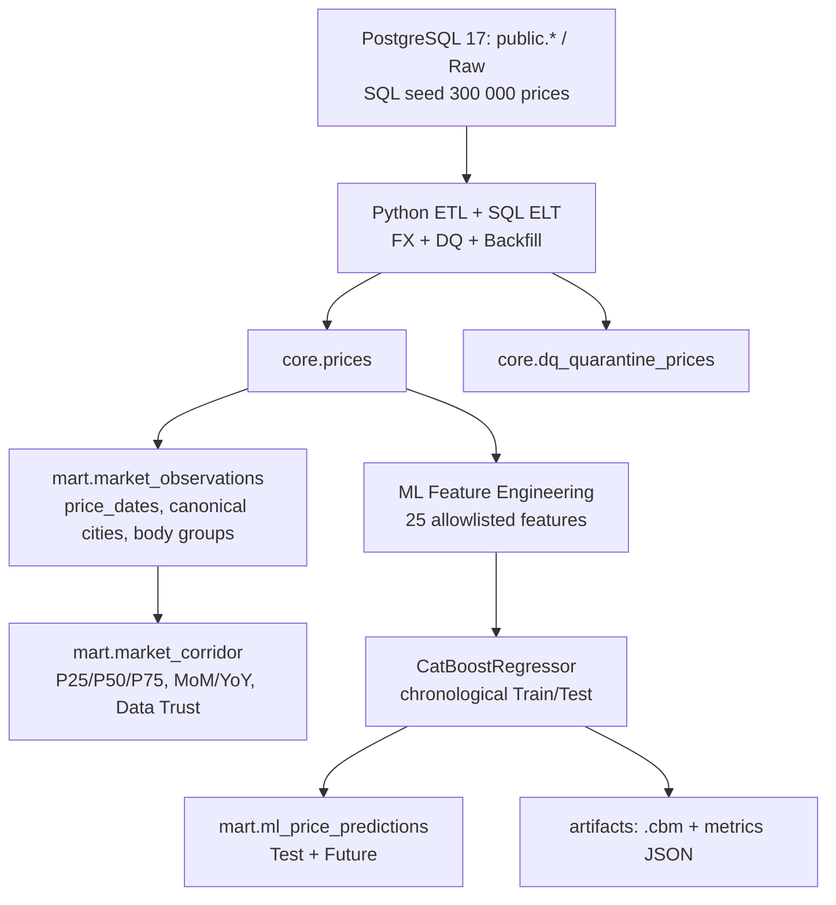

# Smart Logistics Data & ML Platform

Сквозной прототип платформы данных для анализа стоимости грузоперевозок: **PostgreSQL 17 → ETL → DWH → CatBoost ML**. Выполнен в рамках тестового задания Middle Data Engineer. Исходные требования работодателя сохранены в [`task/README.md`](task/README.md).

## Результат

| Компонент | Результат на предоставленном синтетическом наборе |
|---|---:|
| Источник `public.prices` | 300 000 записей |
| Core `core.prices` | 299 797 валидных записей |
| DQ-карантин `core.dq_quarantine_prices` | 203 записи |
| DWH-наблюдения `mart.market_observations` | 291 020 |
| Ячейки рыночных ставок `mart.market_corridor` | 203 644 за 37 месяцев |
| Train / Test / Future | 24 226 / 12 808 / 5 998 |
| Прогнозы `mart.ml_price_predictions` | 18 806 |

**CatBoost на Test:** R² = **0,9238**, MAPE = **15,44%**, RMSE = **52 804,63 ₽**, MAE = **27 226,23 ₽**. Это показатели на синтетическом наборе; они не доказывают такую же точность на реальных данных.

## Архитектура



Оркестрация — Docker Compose: `db` (ожидается `healthy`) → `etl` → `mart` → `ml` (каждая пакетная задача должна завершиться с кодом `0`). Дополнительные Airflow, ClickHouse и Superset не используются: это необязательные бонусы, исключенные ради компактной и воспроизводимой реализации.

**Данные:** БД и таблицы создаются автоматически при *первом* старте на пустом томе. При последующих стартах исходный генератор не запускается снова. ETL на каждый интервал удаляет и восстанавливает соответствующие записи Core и карантина в одной транзакции; материализованные представления DWH пересчитываются последовательно; ML заменяет активный набор прогнозов атомарно.

## Быстрый запуск

### Требования

- Docker Engine с поддержкой Linux-контейнеров и Docker Compose v2+ (команда `docker compose`).
- Рекомендуется не меньше 8 ГБ доступной RAM и достаточно свободного дискового пространства для Python/CatBoost и PostgreSQL.
- PowerShell для запуска Windows-скриптов тестирования (сам пайплайн не зависит от Windows).

### Запуск одной командой на чистой машине

Из корня клонированного репозитория, **без создания `.env` и без ручных миграций**:

```bash
docker-compose up
```

В современных версиях Docker Compose эквивалентная команда — `docker compose up`.
Для запуска в фоне с пересборкой образов: `docker compose up --build -d`.
`compose.yaml` и `docker-compose.yml` содержат одинаковую конфигурацию.

При отсутствии `.env` Compose использует **фиксированный демонстрационный пароль** (`smart_logistics_demo_only`) для локального PostgreSQL. Это допустимо только для воспроизводимого тестового запуска: порт PostgreSQL привязан к `127.0.0.1:55432`, а не публикуется во внешнюю сеть. **Не используйте пароль по умолчанию в production или в сетевом окружении.**

### Опциональная локальная конфигурация пароля

Для собственного пароля до **первой инициализации тома БД** создайте `.env`:

```powershell
Copy-Item .env.example .env
notepad .env
```

Замените `CHANGE_ME_FOR_LOCAL_USE` на пароль, который вы выбрали. `.env` исключен из Git. Если том PostgreSQL уже инициализирован, простая смена переменной окружения **не меняет пароль в существующей базе**; сначала согласуйте безопасную процедуру ротации.

Статусы и логи:

```powershell
docker compose ps --all
docker compose logs --tail=80 etl mart ml
```

**Норма:** `db` — `Up (healthy)`, остальные три one-shot сервиса — `Exited (0)`. Первая инициализация на пустом томе включает генерацию 300 000 строк. **Не используйте** `docker compose down -v` в рабочем окружении, если нужно сохранить данные.

### Повторный полный запуск и Backfill

```powershell
docker compose up --build --force-recreate -d
```

Проверка полной цепочки на существующей БД:

```powershell
powershell.exe -NoProfile -ExecutionPolicy Bypass -File .\tests\verify_full_pipeline.ps1
```

Для окна Backfill в PowerShell можно задать переменные окружения, затем заново запустить ETL и пересчитать downstream-слои:

```powershell
$env:ETL_START_DATE = '2026-10-01'
$env:ETL_END_DATE = '2026-10-26'
docker compose run --rm etl
Remove-Item Env:ETL_START_DATE, Env:ETL_END_DATE
# После отдельного ETL требуется обновить DWH / при необходимости ML:
docker compose up --build --force-recreate -d
```

**Осторожно:** последняя команда запускает полный ETL с настройками по умолчанию; для независимого пересчёта витрины можно выполнить `docker compose run --rm --no-deps mart` при работающей БД, а затем `docker compose run --rm --no-deps ml`. Подробности: [`docs/PIPELINE.md`](docs/PIPELINE.md).

## SQL: примеры проверки

Подключение к базе из контейнера (без передачи пароля в командной строке):

```powershell
docker compose exec db psql -U logistics -d deals_bigdata
```

```sql
-- Рыночный коридор для маршрута по месяцам:
SELECT month, loading_city, unloading_city, body_group, weight_category,
       trips_count, carriers_count, p25_trip, median_trip, p75_trip,
       median_km, mom_pct, yoy_pct, reliability_level
FROM mart.market_corridor
WHERE loading_city = 'Москва'
  AND unloading_city = 'Ростов-на-Дону'
  AND body_group = 'Тент'
  AND weight_category = 'FTL'
ORDER BY month DESC
LIMIT 12;

-- Последняя оценка ML:
SELECT model_name, train_rows, test_rows, future_rows,
       r2, mape_pct, rmse_rub, mae_rub
FROM mart.ml_model_runs
ORDER BY run_id DESC LIMIT 1;

-- Future не должен раскрывать фактические цены:
SELECT COUNT(*) AS leaks
FROM mart.ml_price_predictions
WHERE dataset_split = 'future'
  AND (actual_price_rub IS NOT NULL
    OR abs_error_rub IS NOT NULL OR ape_pct IS NOT NULL);
```

## Тестирование

```powershell
powershell.exe -NoProfile -ExecutionPolicy Bypass -File .\tests\verify_etl.ps1
powershell.exe -NoProfile -ExecutionPolicy Bypass -File .\tests\verify_mart.ps1
powershell.exe -NoProfile -ExecutionPolicy Bypass -File .\tests\verify_ml.ps1
powershell.exe -NoProfile -ExecutionPolicy Bypass -File .\tests\verify_full_pipeline.ps1
powershell.exe -NoProfile -ExecutionPolicy Bypass -File .\tests\verify_repository.ps1
```

**Проверка воспроизводимости на пустой БД** без удаления рабочей базы и без использования `.env`:

```powershell
powershell.exe -NoProfile -ExecutionPolicy Bypass -File .\tests\verify_cleanroom.ps1 -WithoutEnv
```

Скрипт создает **отдельную копию** проекта во временной директории, использует другое имя Compose-проекта и новый Docker Volume. Он исключает из аудиторской копии публикацию порта PostgreSQL на хост (чтобы не конфликтовать с рабочим `55432`) и не удаляет ни рабочие, ни тестовые данные автоматически. Флаг `-WithoutEnv` проверяет именно поведение чистой установки без `.env`; без флага скрипт использует локальный `.env`, как в исходном аудите. Описание — [`docs/FINAL_AUDIT.md`](docs/FINAL_AUDIT.md).

## Методика и ограничения

- Дата снимка жестко определена ТЗ: **2026-10-26**. Даты train/test: `2026-07-26` — `2026-10-04` и `2026-10-05` — `2026-10-26`; будущие заявки — после `2026-10-26`.
- Валюта: RUB (`643`), USD (`840`) и EUR (`978`), только точный курс на `nearest_rate_date`, без fallback по дате погрузки. Невалидные цены/курсы отправляются в карантин с кодами причин.
- `cities.gc_id` не уникален — используется каноническая строка с минимальным `cities.id`. По каждой паре `(месяц, цена, стандартная группа кузова)` исключаются дубли. Месяцы берутся из `price_dates.price_date`.
- Из исторического рынка исключены `is_fact = false`, составные рейсы, `outlier_mark = true` и будущие периоды.
- **Data Trust:** `HIGH` при ≥30 рейсах, ≥5 перевозчиках и свежести ≤30 суток; `MEDIUM` при ≥10 рейсах; остальные — `LOW_DATA`. В текущем синтетическом наборе большинство детальных ячеек имеют `LOW_DATA`; нельзя представлять их как надежные ориентиры.
- `outlier_mark` взят из источника. Для самых свежих записей `2026-10-26` ночная разметка выбросов еще не выполнялась — возможны невыявленные аномалии.
- ML использует только 25 заранее разрешенных признаков без `price`, `price_km`, `outlier_mark` и агрегатов `price_group_stats`/рыночной витрины; на future фактическая стоимость и ошибки не сохраняются. Проект не выполняет гиперпараметрическую оптимизацию по тестовой выборке.
- Это **локальный учебный прототип**, не production-сервис: нет планировщика, мониторинга, централизованного секрет-хранилища и процедур продакшен-деплоя.

## Состав репозитория

- `task/` — неизмененные материалы работодателя.
- `sql/` — Core, ELT, DWH и ML SQL.
- `etl/` — Python-пайплайн.
- `ml/` — признаки, обучение и пакетный прогноз.
- `docker/`, `compose.yaml`, `docker-compose.yml` — контейнеризация.
- `tests/` — SQL-проверки и PowerShell-регрессия.
- `docs/` — детальная архитектура, эксплуатация и аудит.
- `.env.example` — шаблон локальной конфигурации.

Личные рабочие журналы, конспект и реестр вопросов **не входят** в этот репозиторий.
