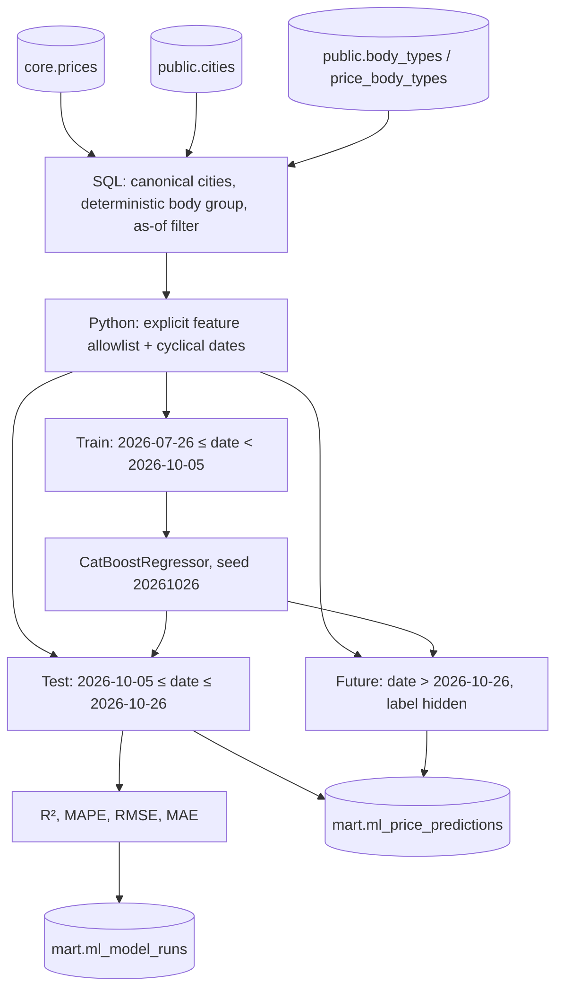

# ML-пайплайн — особенности реализации (этапы 6.1–6.2)

Дата среза зафиксирована: **2026-10-26**. Временные интервалы не зависят от системной даты.

## Путь данных



- Обучаемся на фактических, прямых перевозках без `outlier_mark`, на очищенном `price_rub` в рублях без НДС.
- Городской справочник дедуплицируется `DISTINCT ON (gc_id) ORDER BY gc_id, id`; регион извлекается из `full_name_local` после первой запятой.
- Одна прогнозная строка соответствует одному `price_id`. Основной `core.prices.body_type` приоритетен перед связанными типами, поэтому многозначные `price_body_types` не умножают наблюдения ML; на стороне DWH используется свое зерно «рейс × месяц × группа».
- Систематическая утечка цены пресекается двумя способами: SQL не отдает будущие цены, Python передает в CatBoost **только** перечисленные в `FEATURE_COLUMNS` разрешенные колонки. Таблица `price_group_stats` и текущий `mart.market_corridor` не участвуют.
- Будущие заявки из Core скорятся все, включая типы, не встречавшиеся в тренировке; в реальной системе на сложные направления потребуются отдельные модели/ограничения. Исторические метрики вычисляются **только на test**.
- Сохранение прогнозов: batch `COPY` в транзакции, с сериализацией через `pg_advisory_xact_lock`. При ошибке данные прошлого успешного скоринга сохраняются благодаря rollback. Переобучение с тем же seed проверяется по контрольной сумме бизнес-полей (без `scored_at`).
- `artifacts/` исключена из Git: там веса модели `.cbm` и `ml_metrics.json` конкретного запуска. Для публичного README после проверки можно перенести **только численные метрики**, не локальные пути.
- После интеграции шага 6.2 ML-сервис включен в обычный `docker compose up`; он запускается только после успешного завершения `mart` (`service_completed_successfully`). Отдельный повторный скоринг без зависимостей: `docker compose run --rm --no-deps ml` (при уже запущенной БД).

## Пример бизнес-запроса

```sql
SELECT loading_date, loading_city_gcid, unloading_city_gcid,
       body_group, actual_price_rub, predicted_price_rub,
       abs_error_rub, ape_pct
FROM mart.ml_price_predictions
WHERE dataset_split = 'test'
ORDER BY abs_error_rub DESC
LIMIT 10;
```

## Контроль будущего

```sql
SELECT count(*) AS future_total,
       count(actual_price_rub) AS leaked_actuals,
       count(abs_error_rub) AS leaked_errors
FROM mart.ml_price_predictions
WHERE dataset_split = 'future';
```

Значения `leaked_actuals` и `leaked_errors` должны равняться нулю.
